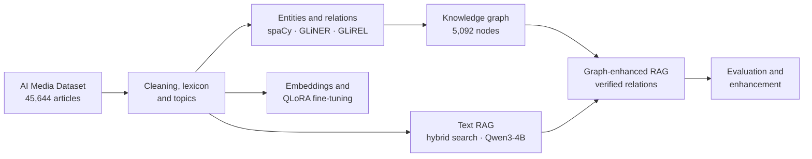
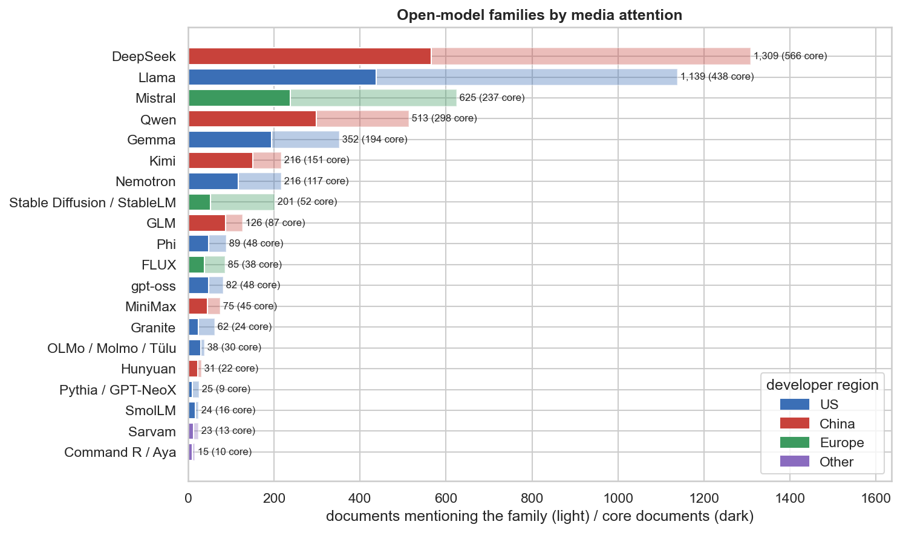
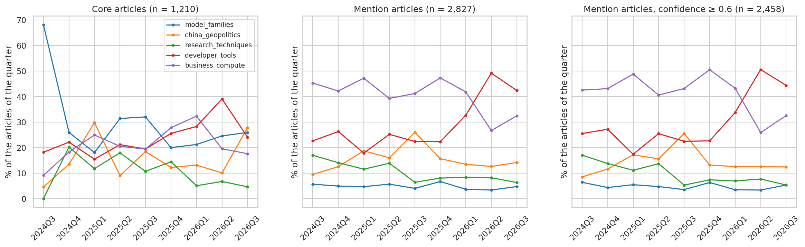
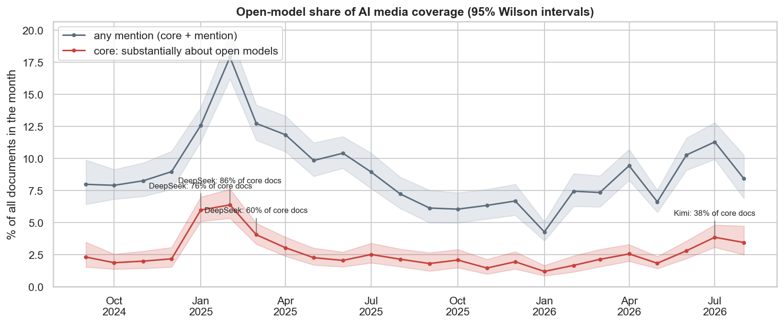
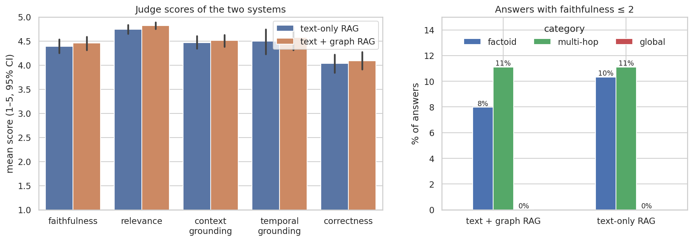

# Tracking Open Models in AI Media

**Text mining, knowledge graphs, fine-tuned compact LLMs and graph-enhanced RAG over two years of AI news.**

| Stage | Notebook |
|---|---|
| 1 · Data, entities, knowledge graph and topics | [](https://colab.research.google.com/github/jihyeon26/computational-language-technology-hs26/blob/main/stage1/stage1_final.ipynb) |
| 2 · Embeddings and fine-tuned compact open models | [](https://colab.research.google.com/github/jihyeon26/computational-language-technology-hs26/blob/main/stage2/stage2_final.ipynb) |
| 3 · RAG question answering with a knowledge graph | [](https://colab.research.google.com/github/jihyeon26/computational-language-technology-hs26/blob/main/stage3/stage3_final.ipynb) |

## Overview

How did the landscape of open-source and open-weight AI models evolve between September 2024 and August 2026, and
can it be explored by asking questions? This project answers both with an end-to-end NLP workflow on the
[AI Media Dataset](https://www.kaggle.com/datasets/jannalipenkova/ai-media-dataset): 45,644 news articles after
cleaning, of which 1,210 are core articles on the **Open Models** track (model families, developers, capabilities,
licences and their relations).

The project was carried out in the course *Computational Language Technologies* of the HSLU MSc in Applied Data
Science and AI, a joint industry-academia project with Anacode GmbH and Google DeepMind.



## Stages

| Stage | Goal | Methods | Key results |
|---|---|---|---|
| **1 · Exploration and knowledge graph** | Map the open-models discourse and build a knowledge graph | GLiNER · GLiREL · NetworkX · topic modelling | Knowledge graph of 5,092 nodes and 999 typed edges, each traced to its source sentence |
| **2 · Representations and fine-tuning** | Compare representations of the AI discourse and their cost | Word2Vec · FastText · Doc2Vec · QLoRA (Qwen3) | QLoRA reaches macro-F1 0.84 on theme classification; Qwen3-1.7B gives the best quality–cost trade-off |
| **3 · RAG question answering** | Answer questions from the articles, with and without the graph | Hybrid search · NLI verification · graph-aware retrieval · LLM judge · re-ranking | Verified graph relations improve retrieval (MRR 0.69 → 0.71); re-ranking raises answer correctness (4.04 → 4.25) |

## Key findings on the open-models track

- **Releases drive the coverage.** Open models are a small but persistent share of AI news, with the strongest peak
  after DeepSeek-R1 in early 2025.
- **From Llama to a US–China story.** Attention moved from Meta's Llama towards Chinese families (Qwen, Kimi, GLM)
  and NVIDIA's Nemotron; the trends of the lexicon and of the knowledge graph agree on this shift.
- **A more precise vocabulary.** *Open-weight* replaces *open-source* in a growing share of mentions.
- **From models to their use.** The discourse moves from research and China–US rivalry towards developer tools and
  agents.
- **Two framings.** Chinese models are mostly discussed through geopolitics, US and European models through tools and
  business.
- **What a knowledge graph adds to RAG.** Its main value for trend monitoring is finding articles through the
  entities they mention rather than the words they share with the question.

| | |
|---|---|
|  |  |
|  |  |

## Methods worth highlighting

- **Evidence over assertion.** Every graph relation used for retrieval is checked against the sentence that states it
  (DeBERTa NLI), lexicon knowledge is kept apart from article claims, and graph facts reach the prompt only together
  with that sentence.
- **Evaluation with checks.** Extraction and relations are compared with human labels, retrieved passages are reviewed
  blind, systems are compared question by question with bootstrap intervals, and the LLM judge is checked against
  human scores and against a higher reasoning effort.
- **Fair comparisons.** Text-only and graph-enhanced RAG share the corpus, chunks, search, prompt and language model;
  only the evidence differs.
- **Reproducibility.** Fixed seeds, cached long steps (NLI scores, answers, judgments), pinned settings
  (`rag_settings.json`, `graph_rag_settings.json`) and reusable code in `src/`.

## Tech stack

- **Data and NLP:** Python, pandas, spaCy
- **Information extraction:** GLiNER, GLiREL, DeBERTa NLI
- **Knowledge graph:** NetworkX
- **Embeddings:** gensim, sentence-transformers
- **Fine-tuning:** Hugging Face Transformers, PEFT (QLoRA)
- **LLMs and evaluation:** Ollama (Qwen3), OpenAI API (LLM as a judge)

## Repository structure

```text
.
├── stage1/  stage2/  stage3/   final notebook of each stage and the notebooks of its parts
├── src/                        reusable modules: knowledge graph construction, graph revision, graph-aware retrieval
├── artifacts/                  small versioned outputs: lexicon, tables, figures, test set, answers, judgments
├── config/                     knowledge graph schema
└── requirements.txt
```

## How to run

Each final notebook opens in Google Colab from the badges above and runs from top to bottom. Small outputs needed to
read and re-run the analysis are versioned in `artifacts/`; large intermediate files (processed corpus, embeddings,
model checkpoints) are kept outside the repository, and the long steps (fine-tuning, generation, judging) are loaded
from a cache when it exists. The raw dataset is available on
[Kaggle](https://www.kaggle.com/datasets/jannalipenkova/ai-media-dataset).

## Team

[Daliasny Gonzalez Guzman](https://github.com/gdaliasny-spec) · [Jennifer Spieser](https://github.com/JenniferSpr) ·
[Jihyeon Choung](https://github.com/jihyeon26)

## Acknowledgements

Course *Computational Language Technologies*, HSLU, organised by Dr. Janna Lipenkova (Anacode GmbH) and Dr. Guang Lu
(HSLU) in collaboration with Dr. Diego Antognini (Google DeepMind). AI coding and writing assistants were used and are
disclosed in each notebook.
